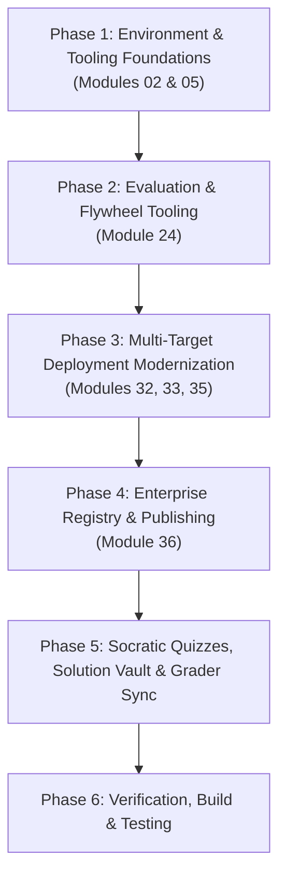

# Technical Plan: Google Agents CLI Modernization & Integration

## Major Components & Sequence

---

## Breakdown by Phase

### Phase 1: Environment & Tooling Foundations (Modules 02 & 05)
- Update `training/module02-environment-setup/` to introduce `uvx google-agents-cli setup` and coding assistant skill binding.
- Update `training/module05-running-agents/` to introduce `agents-cli playground` and compare it with `adk web` / `adk run` / `adk api_server`.

### Phase 2: Evaluation & Quality Flywheel (Module 24)
- Update `training/module24-evaluation/` to incorporate `uvx google-agents-cli eval run` alongside `adk eval`, teaching the complete Quality Flywheel workflow.

### Phase 3: Multi-Target Deployment Modernization (Modules 32, 33, 35)
- Update `training/module32-deployment-cloud-run/` with `agents-cli scaffold enhance --deployment-target cloud_run`.
- Update `training/module33-deployment-gke/` with `agents-cli scaffold enhance --deployment-target gke`.
- Update `training/module35-deployment-agent-runtime/` with the latest `agents-cli` flags and patterns.

### Phase 4: Enterprise Publishing (Module 36)
- Update `training/module36-gemini-enterprise/` to highlight `agents-cli publish gemini` (with ADK and A2A modes).

### Phase 5: Socratic Quizzes, Solution Vault & Grader Sync
- Update `doc/src/data/vaultRegistry.js` and `scripts/generate_vault_registry.py`.
- Sync `scripts/rubrics/definitions.py` if needed.

### Phase 6: Verification & Adversarial Review
- Run `python3 scripts/test_solutions.py` and `python3 scripts/grade_lab.py`.
- Build Docusaurus docs (`npm run build`).
- Run adversarial debate to validate pedagogical quality.
