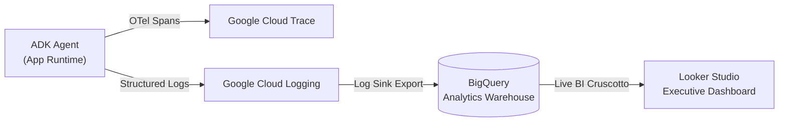

# Module 25: Advanced Observability & Enterprise AgentOps


## Theory

### Why AgentOps & Advanced Observability Matter

In production, agents are non-deterministic, distributed software systems. They execute multi-step reasoning, query external tools, spawn sub-agents, and mutate conversational state across asynchronous sessions. 

Without robust **AgentOps telemetry**, diagnosing why an agent failed, tracking token usage spikes, measuring tool latencies, or detecting cascading exceptions becomes nearly impossible.

The Google ADK provides a multi-tiered observability architecture:
1. **Local-First In-Process Plugins (`BasePlugin`):** Lightweight, zero-dependency interceptors for local debugging, alerting, and metrics collection.
2. **Native OpenTelemetry (OTel):** Standardized distributed tracing that exports performance data and spans directly to **Google Cloud Trace** and **Cloud Monitoring**.
3. **Long-Term Analytics (BigQuery + Looker Studio):** Event streaming to BigQuery for historical analytics, cost governance, and business KPI visualization.

---

### The Four Pillars of Agent Telemetry

A production-grade AgentOps strategy is built on four core pillars:

```
┌────────────────────────────────────────────────────────────────────────┐
│                      FOUR PILLARS OF AGENT TELEMETRY                   │
├─────────────────┬──────────────────┬─────────────────┬─────────────────┤
│ 1. TRACES       │ 2. METRICS       │ 3. LOGS         │ 4. EVENTS       │
│ • End-to-end    │ • Token Counts   │ • Structured    │ • State deltas  │
│   request span  │ • Tool Latency   │   JSON payload  │ • Tool inputs/  │
│ • Node lineage  │ • Error rates    │ • Turn context  │   outputs       │
└─────────────────┴──────────────────┴─────────────────┴─────────────────┘
```


*Figure: The four pillars of agent telemetry—Traces, Metrics, Logs, and Events—unified across distributed agent execution graphs.*

---

### The ADK Plugin Architecture

**Plugins** (`google.adk.plugins.BasePlugin`) are modular, reusable classes that intercept and observe events flowing through an agent's lifecycle without altering business logic or prompt instructions.

```python
from google.adk.plugins import BasePlugin
from google.adk.events import Event

class TurnMetricsPlugin(BasePlugin):
    """Observes tool errors and turn lifecycles."""
    
    async def on_tool_error_callback(self, *, tool, tool_args, tool_context, error):
        print(f"⚠️ [AgentOps Alert] Tool {tool.__name__} failed: {error}")
        # Recover gracefully without crashing the turn
        return {"status": "error", "message": str(error)}

    async def on_event_callback(self, *, event: Event, **kwargs):
        if event.is_final_response():
            print(f" Turn completed successfully for agent: {event.author}")
```

---

### Enterprise Cloud Architecture: OpenTelemetry to Looker Studio

In enterprise Google Cloud environments, ADK integrates natively with OpenTelemetry to pipe telemetry through the entire Google Cloud data stack:



#### Configuring Cloud Trace in Code:
```python
from google.adk.telemetry.google_cloud import get_gcp_exporters
from google.adk.telemetry.setup import maybe_set_otel_providers

# 1. Configure GCP Exporters (Requires google-adk[gcp])
otel_hooks = get_gcp_exporters(
    enable_cloud_tracing=True,
    enable_cloud_metrics=True
)

# 2. Register OpenTelemetry providers
maybe_set_otel_providers(otel_hooks_to_setup=[otel_hooks])
```

---

### Key Takeaways
- **Separation of Concerns:** Business logic stays in `Agent(instruction=...)` and tools; operational monitoring stays in `BasePlugin` and OpenTelemetry hooks.
- **Local-First Debugging:** You can build and verify complete alerting and error recovery plugins locally in seconds without cloud credentials.
- **Enterprise Ready:** Flipping on `get_gcp_exporters` instantly hooks your agent into Google Cloud Trace and BigQuery logging.

---

### 🧠 Socratic Knowledge Check

<details>
<summary><b>1. What happens if a tool raises an unhandled exception and no plugin handles <code>on_tool_error_callback</code>?</b></summary>
The exception propagates up the call stack, halting the agent runner and failing the user's turn. Returning a recovery dictionary from <code>on_tool_error_callback</code> allows the agent to inform the LLM of the error and attempt recovery.
</details>

<details>
<summary><b>2. Why is <code>event.is_final_response()</code> crucial for tracking turn completion?</b></summary>
An agent may emit multiple intermediate events (e.g. tool calls, thinking steps, thoughts). <code>is_final_response()</code> indicates that the model has finished its entire turn and delivered the final response to the user.
</details>

<details>
<summary><b>3. What is the key advantage of streaming agent logs to BigQuery for Looker Studio?</b></summary>
It allows business leaders and SRE teams to analyze long-term agent trends: token consumption, cost per user, tool success rates, and user drop-off over thousands of historical sessions.
</details>
