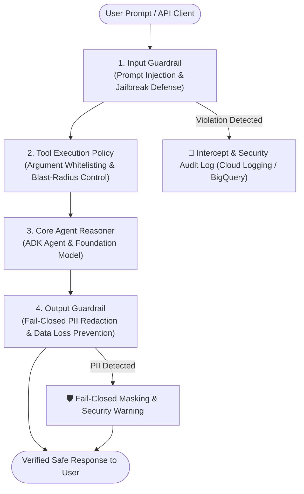

# Module 25.5: Responsible AI (RAI) & Safety Plugins


## Theory

Observability (Module 25) lets you see what your agent is doing. **Responsible AI (RAI) & Safety Plugins** let you *govern and control* what your agent is allowed to process and output. In enterprise environments, you cannot rely solely on the model's internal prompt alignment; you need a programmatic, deterministic **Defense-in-Depth Guardrail System** that enforces organizational security, privacy, and compliance policies.

### The Four Guardrail Layers of Enterprise AI

Enterprise agent applications deploy multi-layered guardrails:



1. **Input Guardrail (Layer 1)**: Intercepts inbound prompts before the LLM reasons (`before_model_callback`), blocking prompt injections, jailbreak templates, and unauthorized system override attempts.
2. **Tool Execution Policy (Layer 2)**: Intercepts tool calls (`before_tool_callback` / `on_tool_error_callback`), verifying that tool arguments remain within permissible business boundaries.
3. **Core Agent Reasoner (Layer 3)**: Foundational LLM reasoning guided by system instructions and safety settings.
4. **Output Guardrail (Layer 4)**: Intercepts generated responses (`on_event_callback`), inspecting final text for PII (credit cards, SSNs, API keys) or harmful content, enforcing strict **Fail-Closed** data redaction.

### The "Fail-Closed" vs "Fail-Open" Paradigm


*Figure: Real-time fail-closed safety interception pipeline intercepting violations before response delivery.*

* **Fail-Open (Dangerous)**: If a guardrail fails or times out, the unverified LLM output is delivered to the user.
* **Fail-Closed (Enterprise Standard)**: If a guardrail detects a violation, times out, or encounters an internal evaluation error, the unverified output is **withheld** and replaced with a deterministic, sanitized response while logging an audit event.

### Implementing Multi-Layered Safety with ADK Plugins

ADK 2.0 plugins are ideal for safety because they operate outside the LLM reasoning loop with full access to `Event` and `LlmRequest` objects:

```python
import re
from google.adk.plugins import BasePlugin
from google.adk.events import Event

class PIIGuardrailPlugin(BasePlugin):
    """Fail-Closed output guardrail: redacts financial identifiers."""
    def __init__(self, name: str = 'pii_guardrail'):
        super().__init__(name)
        self.cc_pattern = re.compile(r"\b\d{4}-\d{4}-\d{4}-\d{4}\b")

    async def on_event_callback(self, *, event: Event, **kwargs):
        if event.is_final_response() and event.content and event.content.parts:
            response_text = event.content.parts[0].text
            
            # Check for PII pattern
            if response_text and self.cc_pattern.search(response_text):
                # 🛡️ THE INTERVENTION: Replace output with safe warning
                event.content.parts[0].text = (
                    "🛑 [SECURITY BLOCK] This response was withheld because it contained "
                    "sensitive financial information (PII)."
                )
                print(f"🛑 [SAFETY AUDIT] Blocked PII in invocation: {getattr(event, 'invocation_id', 'unknown')}")
```

### Why use a Plugin for Responsible AI?

1. **Centralized Enterprise Governance**: A single compliance plugin can be attached across an entire fleet of agents without modifying their individual instructions.
2. **Deterministic Security**: Unlike probabilistic system prompts that can be bypassed via sophisticated prompt injection, programmatic Python plugins run deterministically.
3. **Auditability & Compliance**: Safety plugins can stream intervention logs to **BigQuery** or **Cloud Logging** for regulatory compliance (GDPR, HIPAA, PCI-DSS).

<KnowledgeCheck
  id="m25-5-fail-closed-safety"
  question="Why is the 'Fail-Closed' architectural pattern considered mandatory for enterprise Responsible AI (RAI) guardrails?"
  options={[
    "Because it guarantees that unverified or potentially sensitive LLM responses are never exposed to the end user if a safety check triggers or encounters an error",
    "Because it turns off all cloud networking to save compute costs",
    "Because it forces all agents to use single-threaded synchronous Python code",
    "Because it prevents developers from writing unit tests"
  ]}
  correctIndex={0}
  hint="Consider the risk of leaking sensitive data when a safety evaluator flags a violation or fails."
  explanation="In a Fail-Closed architecture, any triggered safety rule, timeout, or evaluator failure immediately blocks the raw response, replacing it with a safe fallback to prevent data leakage or compliance breaches."
/>

### Key Takeaways
- **RAI is a core production requirement**: Enterprise AI systems require defense-in-depth across input, tool, and output stages.
- **Fail-Closed Guarantee**: Unsafe or unverified messages are blocked deterministically before reaching the user.
- **Separation of Concerns**: Safety rules live in modular plugins rather than cluttering core agent instructions.
- **Audit Lineage**: Every safety intervention records telemetry for compliance and threat analysis.
