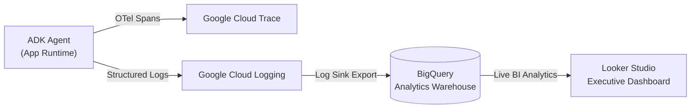

# Module 26: Advanced Observability & Enterprise AgentOps


## Theory

### Why AgentOps & Advanced Observability Matter

> **🧭 Completing the Callback & Plugin Triad (Modules 25 → 25.5 → 26):** In **Module 25**, you learned the six node-level lifecycle callbacks; in **Module 25.5**, you elevated them into `App`-level `BasePlugin` guardrails for Responsible AI safety. Here in **Module 26**, we apply that exact same `BasePlugin` architecture—paired with **OpenTelemetry**—to gain deep operational visibility across your entire agent fleet!

In production, agents are non-deterministic, distributed software systems. They execute multi-step reasoning, query external tools, spawn sub-agents, and mutate conversational state across asynchronous sessions. 

Without robust **AgentOps telemetry**, diagnosing why an agent failed, tracking token usage spikes, measuring tool latencies, or detecting cascading exceptions becomes nearly impossible.

The Google ADK provides a multi-tiered observability architecture:
1. **Local-First In-Process Plugins (`BasePlugin`):** Lightweight, zero-dependency interceptors for local debugging, alerting, and metrics collection.
2. **Native OpenTelemetry (OTel):** Standardized distributed tracing that exports performance data and spans directly to **Google Cloud Trace** and **Cloud Monitoring**.
3. **Long-Term Analytics (BigQuery + Looker Studio):** Event streaming to BigQuery for historical analytics, cost governance, and business KPI visualization.

---

### The Four Pillars of Agent Telemetry

A production-grade AgentOps strategy is built on four core pillars:

```
┌────────────────────────────────────────────────────────────────────────┐
│                      FOUR PILLARS OF AGENT TELEMETRY                   │
├─────────────────┬──────────────────┬─────────────────┬─────────────────┤
│ 1. TRACES       │ 2. METRICS       │ 3. LOGS         │ 4. EVENTS       │
│ • End-to-end    │ • Token Counts   │ • Structured    │ • State deltas  │
│   request span  │ • Tool Latency   │   JSON payload  │ • Tool inputs/  │
│ • Node lineage  │ • Error rates    │ • Turn context  │   outputs       │
└─────────────────┴──────────────────┴─────────────────┴─────────────────┘
```


*Figure: The four pillars of agent telemetry—Traces, Metrics, Logs, and Events—unified across distributed agent execution graphs.*

---

### The ADK Plugin Architecture for Telemetry & Error Recovery

Building on the `BasePlugin` pattern from **Module 25.5** (where plugins intercepted `before_model_callback` and `on_event_callback` to block unsafe content), observability plugins use hooks like **`on_tool_error_callback`** and **`on_event_callback`** to record operational metrics, fire alerts, and gracefully recover from tool exceptions across every agent in `App(plugins=[...])` without cluttering prompt instructions or tool code.

```python
from google.adk.plugins import BasePlugin
from google.adk.events import Event

class TurnMetricsPlugin(BasePlugin):
    """Observes tool errors and turn lifecycles."""
    
    async def on_tool_error_callback(self, *, tool, tool_args, tool_context, error):
        print(f"⚠️ [AgentOps Alert] Tool {tool.name} failed: {error}")
        # Recover gracefully without crashing the turn
        return {"status": "error", "message": str(error)}

    async def on_event_callback(self, *, event: Event, **kwargs):
        if event.is_final_response():
            print(f"Turn completed successfully for agent: {event.author}")
```

---

### Enterprise Cloud Architecture: OpenTelemetry to Looker Studio

In enterprise Google Cloud environments, ADK integrates natively with OpenTelemetry to pipe telemetry through the entire Google Cloud data stack:



#### Configuring Cloud Trace in Code:
```python
from google.auth.exceptions import DefaultCredentialsError
from google.adk.telemetry.google_cloud import get_gcp_exporters
from google.adk.telemetry.setup import maybe_set_otel_providers

# Configure GCP Exporters when Application Default Credentials are available
# (Requires google-adk[gcp]; degrades gracefully in local API-key-only dev)
try:
    otel_hooks = get_gcp_exporters(
        enable_cloud_tracing=True,
        enable_cloud_metrics=True,
    )
    maybe_set_otel_providers(otel_hooks_to_setup=[otel_hooks])
except DefaultCredentialsError:
    print("ℹ️ Running locally without GCP ADC; skipping Cloud Trace export.")
```

---

### Key Takeaways
- **Separation of Concerns:** Business logic stays in `Agent(instruction=...)` and tools; operational monitoring stays in `BasePlugin` and OpenTelemetry hooks.
- **Local-First Debugging:** You can build and verify complete alerting and error recovery plugins locally in seconds without cloud credentials.
- **Enterprise Ready:** Flipping on `get_gcp_exporters` instantly hooks your agent into Google Cloud Trace and BigQuery logging.

---

### 🧠 Interactive Knowledge Check

<KnowledgeCheck
  id="m26-plugin-error-recovery"
  question="What happens inside an ADK BasePlugin when on_tool_error_callback returns a recovery dictionary like {'status': 'error', 'message': '...'} instead of None?"
  options={[
    "The unhandled tool exception is caught and converted into a structured tool response so the agent can recover gracefully",
    "The Python process immediately exits with status code 1",
    "The runner deletes the current session and restarts from Turn 0",
    "OpenTelemetry spans are permanently disabled for the rest of the session"
  ]}
  correctIndex={0}
  hint="Review how TurnMetricsPlugin handles tool failures in on_tool_error_callback."
  explanation="Returning a dict from on_tool_error_callback intercepts the raised Python exception and feeds that dict back to the LLM as the tool's response, allowing graceful recovery while still recording the failure metric."
/>

<details>
<summary><b>1. What happens if a tool raises an unhandled exception and no plugin handles <code>on_tool_error_callback</code>?</b></summary>

The exception propagates up the call stack, halting the agent runner and failing the user's turn. Returning a recovery dictionary from <code>on_tool_error_callback</code> allows the agent to inform the LLM of the error and attempt recovery.
</details>

<details>
<summary><b>2. Why is <code>event.is_final_response()</code> crucial for tracking turn completion?</b></summary>

An agent may emit multiple intermediate events (e.g. tool calls, thinking steps, thoughts). <code>is_final_response()</code> indicates that the model has finished its entire turn and delivered the final response to the user.
</details>

<details>
<summary><b>3. What is the key advantage of streaming agent logs to BigQuery for Looker Studio?</b></summary>

It allows business leaders and SRE teams to analyze long-term agent trends: token consumption, cost per user, tool success rates, and user drop-off over thousands of historical sessions.
</details>

---

### Closing Out Part 4: Ready for External Protocols & UIs (Part 5)

This closes out **Part 4: Production Readiness**! Over Modules 22 through 26, you equipped your agents with persistent sessions and memory (`SessionService` & `MemoryService`), versioned binary/text artifacts (`ArtifactService`), golden-trajectory evaluation (`adk eval`), lifecycle callbacks (`Module 25`), fail-closed RAI safety plugins (`Module 25.5`), and OpenTelemetry AgentOps observability (`Module 26`).

Next, in **Part 5: Ecosystem Protocols & Multimodal Interfaces**, you will connect these hardened, observable agents to external tool servers, remote agent fleets, and live user interfaces—starting in **Module 27** with the **Model Context Protocol (MCP)**!
