# Module 31: Production Deployment Strategies

## Theory


*Figure: Enterprise AgentOps lifecycle and deployment framework evaluating speed, compliance, session persistence, cost, and architectural control.*

### Welcome to Part 6: Enterprise AgentOps with `google-agents-cli`

Building an agent that works in a local script is only the halfway mark. Shipping an **enterprise-grade agent** requires deterministic dependency management, built-in Agent-to-Agent (A2A) interoperability, systematic LLM-as-judge evaluation gates, Infrastructure-as-Code (Terraform), CI/CD promotion pipelines, and zero-trust runtime governance.

Throughout Part 6, you will build, evaluate, containerize, deploy, and govern a single canonical Python agent — **`support-ops-agent`** powered by **`gemini-3.8-flash`** — using the **Google Agents CLI (`google-agents-cli`)**. Installed once via `uv tool install google-agents-cli`, `agents-cli` provides a unified operational toolchain across every Google Cloud runtime target.

---

### The 7-Phase `agents-cli` Lifecycle

Rather than bolting on Dockerfiles, A2A routers, evaluation harnesses, and Terraform modules manually at the end of a project, `agents-cli` guides every agent through a disciplined **prototype-first, eval-gated 7-phase lifecycle**:

```mermaid
flowchart LR
    P1["1. Setup (agents-cli setup)"] --> P2["2. Prototype Scaffold (scaffold create --prototype)"]
    P2 --> P3["3. Local Iteration (run / playground)"]
    P3 --> P4["4. Quality Flywheel (eval run & eval compare)"]
    P4 -->|"Refine prompts & tools"| P3
    P4 -->|"Metrics pass bar"| P5["5. Enhance & IaC (scaffold enhance & infra)"]
    P5 --> P6["6. Cloud Rollout (agents-cli deploy)"]
    P6 --> P7["7. Enterprise Registration (publish gemini)"]
```



| Phase | Core `agents-cli` Commands | Purpose & Engineering Deliverable |
| :--- | :--- | :--- |
| **1. Setup** | `uv tool install google-agents-cli`<br/>`agents-cli setup --skip-auth` | Installs the `agents-cli` binary globally and syncs the official AgentOps workflow skills into your coding agent environment. |
| **2. Prototype Scaffold** | `agents-cli scaffold create support-ops-agent --agent adk --prototype` | Generates the standardized ADK project layout, FastAPI + A2A serving harness, and evaluation suite **without** premature cloud Terraform clutter. |
| **3. Local Iteration** | `agents-cli install` · `agents-cli lint`<br/>`agents-cli run "..." --start-server`<br/>`agents-cli playground` | Syncs dependencies with `uv`, runs `ruff`/type checks, executes fast multi-turn CLI smoke tests against a warm local server, and launches the browser playground. |
| **4. Quality Flywheel** | `agents-cli eval run`<br/>`agents-cli eval compare <base> <cand>` | Generates traces over `tests/eval/datasets/`, grades tool trajectories and response quality into `artifacts/grade_results/`, and diffs runs to prevent regressions. |
| **5. Enhance & IaC** | `agents-cli scaffold enhance . --deployment-target <target>`<br/>`agents-cli infra single-project` / `infra cicd` | Upgrades the prototype **in place** (preserving `app/agent.py` and `.env`) with modular Terraform (`deployment/terraform/`), CI/CD pipelines, and Locust load tests. |
| **6. Deploy** | `agents-cli deploy` | Packages, builds, and rolls out the container to **Agent Runtime**, **Cloud Run**, or **GKE Autopilot**, writing `deployment_metadata.json` when applicable. |
| **7. Publish & Observe** | `agents-cli publish gemini` | Registers the live agent with **Gemini Enterprise** (native ADK `:streamQuery` or A2A protocol) with Cloud Trace and BigQuery Agent Analytics telemetry. |

---

### Scaffolded Project Anatomy

Running `agents-cli scaffold create support-ops-agent --agent adk --prototype --agent-guidance-filename GEMINI.md` produces a clean, production-ready repository layout:

```text
support-ops-agent/
├── agents-cli-manifest.yaml      # Canonical project manifest (target, root_agent_name, agent_directory)
├── GEMINI.md                     # Coding-agent guidance & repository architecture conventions
├── pyproject.toml                # Managed dependencies (google-adk, fastapi, uvicorn, a2a-sdk)
├── Dockerfile                    # Single-stage uv container serving uvicorn app.fast_api_app:app
├── .env                          # Local AI Studio key OR Gemini Enterprise / Vertex AI config
├── app/
│   ├── __init__.py
│   ├── agent.py                  # YOUR CODE: root_agent + App(root_agent=root_agent, name="app")
│   ├── fast_api_app.py           # Unified FastAPI entrypoint (/run_sse, /apps/..., and /a2a/app)
│   └── app_utils/
│       ├── a2a.py                # Built-in A2A AgentCard & JSON-RPC endpoint wiring
│       └── services.py           # Session backend resolver (in_memory, cloud_sql, agent_platform_sessions)
└── tests/
    └── eval/
        ├── eval_config.yaml      # Built-in & custom metric selection (metrics_to_run)
        └── datasets/
            └── basic-dataset.json # Inference prompts for agents-cli eval run
```

* **`agents-cli-manifest.yaml`:** Records your project configuration (`agent_directory: "app"`, `root_agent_name`, `deployment_target`, `session_type`) so `agents-cli info`, `scaffold enhance`, `deploy`, and `scaffold upgrade` stay synchronized.
* **`GEMINI.md`:** Context file automatically tailored to your IDE/coding agent (`GEMINI.md`, `CLAUDE.md`, or `AGENTS.md`) documenting exact commands and safe-edit boundaries.
* **`app/agent.py`:** The primary file you author. Defines tools, callbacks, `root_agent`, and `app = App(root_agent=root_agent, name="app")`.
* **`app/fast_api_app.py` & `app/app_utils/a2a.py`:** Every Python ADK project scaffolded by `agents-cli` ships with **Agent-to-Agent (A2A) protocol support built in** under `/a2a/{app_name}` (including `/.well-known/agent-card.json` and JSON-RPC task execution) alongside ADK's native `/run_sse` routes. Never hand-write A2A server boilerplate from scratch.
* **`tests/eval/`:** Pre-wired evaluation suite consumed by `agents-cli eval run`, writing timestamped HTML and JSON scorecards to `artifacts/grade_results/`.

#### The 4 Critical `agents-cli` Rules

Violating any of these four invariants is the #1 cause of scaffolding or runtime session errors:

1. **Project name `<= 26` characters:** Must contain **only** lowercase letters (`a-z`), digits (`0-9`), and hyphens (`-`) — for example, `support-ops-agent` (17 chars). Service accounts and Terraform resource IDs derive from this name and hit GCP length caps above 26 characters.
2. **NEVER `mkdir` before `agents-cli scaffold create`:** Run `scaffold create` from the parent workspace directory. The CLI creates `support-ops-agent/` itself; pre-creating an empty folder causes `create` to fail or misdetect an existing directory.
3. **Keep `App(root_agent=root_agent, name="app")` matching `agent_directory: "app"`:** ADK's HTTP server and `agents-cli eval` route sessions by directory name. Changing `name="app"` to `name="support_ops_agent"` while code lives in `app/` causes `"Session not found"` errors.
4. **Keep `Agent(name="support_ops_agent")` synchronized with `root_agent_name` in `agents-cli-manifest.yaml`:** Ensures trace attribution, evaluation harnesses, and generated A2A `AgentCard` metadata reference the exact root agent identifier.

---

### The Deployment Target Decision Matrix


*Figure: Architecture comparison matrix across Agent Runtime (Managed Compliance & Sessions), Google Cloud Run (Serverless Container Control), and Google Kubernetes Engine Autopilot (Cluster & Hardware Control).*

When your prototype passes its evaluation bar in Phase 4, you promote it with `agents-cli scaffold enhance . --deployment-target <target>`. All three targets build and run the **exact same `Dockerfile`**, differing in operational control, session management, networking, and compliance:

| Criteria | Agent Runtime (`agent_runtime`) | Cloud Run (`cloud_run`) | GKE Autopilot (`gke`) |
| :--- | :--- | :--- | :--- |
| **Operational Model** | Fully managed agent runtime in Gemini platform (no `gcloud` service plumbing; managed via `agents-cli deploy`) | Managed serverless containers with instant revision traffic splitting & scale-to-zero | Full Kubernetes cluster orchestration (Pods, HPA, Deployments, Workload Identity) |
| **Session Backends (`--session-type`)** | **Managed automatically** (`VertexAiSessionService` wired by platform; omit/clear `session_type` in code) | `in_memory` (dev), `cloud_sql` (managed Postgres 15 w/ IAM auth), or `agent_platform_sessions` | `in_memory` (dev), `cloud_sql` (Postgres 15 w/ IAM auth), or `agent_platform_sessions` |
| **Networking & Ingress** | VPC Service Controls (VPC-SC), Private Service Connect interfaces (`--network-attachment`), Agent Gateway (`--agent-gateway-ingress` / `--agent-gateway-egress`) | Public HTTPS, Direct VPC Egress, Identity-Aware Proxy (`--iap`), internal/GCLB ingress | Kubernetes `NetworkPolicy`, Gateway API, private clusters, multi-service mesh |
| **Cost Model** | vCPU-hours + memory-hours (**not billed when idle** when `min-instances=0`) | Per-instance-second + optional `--min-instances` warm capacity | Autopilot Pod resource requests (or Standard node pools / GPU nodes) |
| **Compliance & Security** | **FedRAMP**, HIPAA, PCI, CMEK (`--key`), Agent Identity (`--agent-identity`) | HIPAA, PCI, IAM / IAP authentication, Secret Manager (`--secrets`) | Customizable for HIPAA/PCI/sovereign controls (higher DevOps responsibility) |
| **OAuth / Live / Eventarc Specifics** | **Required for managed OAuth 2.0 user consent** in Gemini Enterprise; Live needs `--min-instances 1`; Eventarc/Pub/Sub via `/api` passthrough | **Simplest for Eventarc & Pub/Sub** (`/apps/{app}/trigger/*`); Live voice agents need `--timeout 3600 --min-instances 1`; no managed user OAuth consent | Custom GPU hardware acceleration, sidecars, high-density microservices, and K8s Jobs |

#### Quick Architectural Heuristics
* **🚀 Rapid Serverless APIs, Webhooks, A2A Microservices, or Eventarc Triggers → `cloud_run`:** Fastest container iteration (Module 32), revision-based instant traffic rollback, Identity-Aware Proxy (`--iap`), and pay-per-request scaling.
* **☸️ Kubernetes Standardization, Fine-Grained `NetworkPolicy`, or GPUs → `gke`:** Full Kubernetes control over pod topology, custom hardware, and cluster-internal service meshes (Module 33).
* **🛡️ FedRAMP Compliance, Managed Sessions, Agent Identity, or OAuth User Consent → `agent_runtime`:** Zero-ops managed infrastructure with automatic `VertexAiSessionService`, CMEK encryption, and native Gemini Enterprise OAuth delegation (Module 35).

### Platform-First Security

ADK and `agents-cli` follow a **platform-first security model**: rather than writing brittle TLS, DDoS, or token verification middleware inside `app/agent.py`, you delegate transport and identity enforcement to the cloud runtime and least-privilege Terraform service accounts (`app_sa` for runtime execution, `cicd_runner_sa` for CI/CD).

| Security Capability | Agent Runtime | Cloud Run | GKE Autopilot |
| :--- | :--- | :--- | :--- |
| **HTTPS / Managed TLS** | ✅ Automatic | ✅ Automatic | ⚙️ Ingress / Gateway config |
| **DDoS Protection** | ✅ Automatic | ✅ Automatic | ⚙️ Cloud Armor via GCLB |
| **Caller Authentication** | ✅ IAM & OAuth 2.0 | ✅ IAM & IAP (`--iap`) | ⚙️ Workload Identity / Istio |
| **Customer-Managed Keys (CMEK)** | ✅ `--key` / Terraform | ✅ Service CMEK | ✅ Node & PV CMEK |
| **Audit Logging** | ✅ Cloud Audit Logs | ✅ Cloud Audit Logs | ✅ Cloud Audit + K8s Audit |

<KnowledgeCheck
  id="m31-deployment-strategy-choice"
  question="You are kicking off an enterprise ADK agent project that must iterate quickly as a local prototype, pass automated trajectory and quality evaluations before any cloud infrastructure is added, and ultimately deploy to a FedRAMP-compliant runtime supporting managed OAuth 2.0 user consent. Which workflow and target combination is correct?"
  options={[
    "Run 'mkdir my_enterprise_agent_project_with_very_long_name' first, skip evaluation, and run 'adk web --host 0.0.0.0' on an unmanaged VM",
    "Run 'agents-cli scaffold create support-ops-agent --agent adk --prototype', iterate with 'agents-cli run' and 'agents-cli eval run' / 'eval compare', then upgrade in place with 'agents-cli scaffold enhance . --deployment-target agent_runtime' and 'agents-cli deploy'",
    "Set 'App(root_agent=root_agent, name=\"custom_name\")' inside 'app/agent.py' and hand-write a custom A2A JSON-RPC server from scratch",
    "Deploy directly to Cloud Run because Cloud Run is the only target with built-in FedRAMP certification and managed Gemini OAuth user consent"
  ]}
  correctIndex={1}
  hint="Combine the prototype-first 'agents-cli' Quality Flywheel (<= 26 char name, no pre-mkdir, eval gate) with the only target offering FedRAMP + managed OAuth user consent."
  explanation="Starting with 'agents-cli scaffold create <name> --agent adk --prototype' lets you validate behavior locally via 'agents-cli run' and the 'eval run' / 'eval compare' Quality Flywheel before adding Terraform/CI/CD via 'scaffold enhance . --deployment-target agent_runtime' — the managed Gemini platform target that supports FedRAMP compliance, automatic sessions, and OAuth 2.0 user consent."
/>

### Key Takeaways
* **7-Phase `agents-cli` Lifecycle:** Standardizes enterprise AgentOps from `setup` and `scaffold create --prototype` through local `run`/`playground`, the `eval run` & `eval compare` Quality Flywheel, `scaffold enhance`, `deploy`, and `publish gemini`.
* **Built-In A2A & Clean Separation:** Scaffolded Python ADK apps automatically serve both ADK SSE (`/run_sse`) and A2A (`/a2a/{app_name}/.well-known/agent-card.json`) via `app/fast_api_app.py` while isolating your business logic in `app/agent.py`.
* **4 Non-Negotiable Rules:** Keep project names `<= 26` lowercase alphanumeric/hyphen characters, never `mkdir` before `scaffold create`, keep `App(..., name="app")` aligned with `agent_directory: "app"`, and keep `Agent(name=...)` aligned with `root_agent_name` in `agents-cli-manifest.yaml`.
* **Target Selection:** Choose **Cloud Run** for fast serverless containers, A2A APIs, and Eventarc triggers; **Agent Runtime** for FedRAMP compliance, zero-ops managed sessions, Agent Gateway, and OAuth user consent; and **GKE Autopilot** for Kubernetes standardization, custom `NetworkPolicy`, and GPU workloads.
